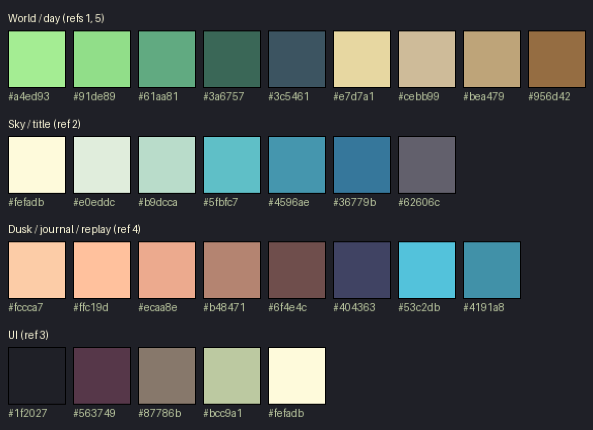

# Art direction

**Owner:** C · **Feeds:** `09` (all art tasks), `04` (rendering, filters), `05`/`06`/`08` (UI, journal, gallery, landing)

## In one line

A bright, clean Pokémon Black/White-style overworld that you inherit, seen as a small island adrift in the sky,
with dusk and memory painted in peach and plum.

## Pillars

1. **Readable at a glance.** The world never explains itself, so every plot state has to read from its sprite alone, at game scale, without hovering. Clean shapes and strong contrast between states (`ripe` vs `rotten`, `full` vs `cracked`) matter more than detail.
2. **Bright by day, warm at dusk.** Daytime is saturated mint and green on sand. As the turn ends, the light slides to peach and then plum. Dusk is the mood of the journal, the graveyard and the replay.
3. **Small and bounded.** Each world is one island you can see the edges of. The title screen and gallery show it literally, as a floating island.
4. **Quiet, not cute-loud.** No mascots, no bouncing UI and no confetti. Motion is slow (clouds, water, a drifting island).

## References (style only)

The references are described here, not committed. They're used for style and palette only: nothing is traced or copied.
The Pokémon screenshots are Nintendo/Game Freak's, image 2 is a watermarked stock image, and image 4 is a signed artist's piece.

| Ref | What we take | Where it's used |
|---|---|---|
| 1. Pokémon BW city overworld | ¾ top-down; mint and bright greens; sandy paths; rows of round dark trees as walls; brown ledge edges; clean dark outlines on objects | The world during play |
| 2. Floating island in the sky | A cut-out island with a grassy top and a brown cliff underside, teal sky, soft cream clouds | Title/landing, gallery thumbnails, loading |
| 3. 16 px item icons on near-black | Chunky icons with 1 px dark outlines, a bright highlight, a limited palette per icon | HUD and hotbar icons, UI panels |
| 4. Dusk coast | Peach sky, plum cliffs, turquoise water | End-of-turn dusk tint, journal, graveyard, replay backgrounds |
| 5. Pokémon BW house and paths | Sandy paths looping round buildings, light grass, readable small character | Plot and path layout feel, player scale |

## Sources (decided)

| Use | Pack | Licence |
|---|---|---|
| Terrain, trees, deco, player, items, UI frames, fonts, music, SFX | [Ninja Adventure](https://pixel-boy.itch.io/ninja-adventure-asset-pack) (Pixel-Boy & AAA) | CC0 |
| HUD and hotbar icons (food, water, stamina, 8 actions) | [Kyrise's Free 16x16 RPG Icon Pack](https://kyrise.itch.io/kyrises-free-16x16-rpg-icon-pack) | CC BY 4.0, credit required |

Rejected: Sprout Lands and Cute Fantasy, whose free tiers are non-commercial and forbid redistribution (a public repo counts as redistribution).
Serene Village (CC BY) is closest to Pokémon BW, but it has no characters or farming and would make a second art family.
Licences and credits are tracked in [`ASSETS.md`](../../ASSETS.md).

## Technical rules

- **Tile size 16 px**, rendered at an **integer scale of 3×** (48 px per tile) with nearest-neighbour sampling. At 1280×720 that shows about 26×15 tiles, so the 32×32 map scrolls with the camera.
- **Outlines:** objects, plots, characters and icons have a 1 px dark outline (`ink` or a darker shade of the object's colour). Terrain has no outlines.
- **Light from the top-left.** Shadows fall down and to the right, as a flat `shadow` colour at about 40% opacity, never blurred.
- **No sub-pixel motion.** Positions snap to the 16 px art grid × scale. The only smooth motion is camera follow and cloud parallax.
- **Recolour only when needed.** Use Ninja Adventure's colours as they are. If a sprite clashes with the palette below (for example a very different grass green), recolour it to the nearest palette colour and note "modified" in `ASSETS.md`.

## Palette

Use these as tokens in code (`src/ui/theme`) so the UI matches the world.

| Group | Tokens |
|---|---|
| **World / day** | `grass-light #a4ed93` · `grass #91de89` · `grass-shade #61aa81` · `tree #3a6757` · `shadow #3c5461` · `path #e7d7a1` · `path-shade #cebb99` · `dirt #bea479` · `ledge #956d42` |
| **Sky / title** | `cloud #fefadb` · `cloud-shade #e0eddc` · `mist #b9dcca` · `sky #5fbfc7` · `sky-mid #4596ae` · `sky-deep #36779b` · `rock #62606c` |
| **Dusk / journal / replay** | `peach-light #fccca7` · `peach #ffc19d` · `rose #ecaa8e` · `clay #b48471` · `bark #6f4e4c` · `plum #404363` · `sea #53c2db` · `sea-deep #4191a8` |
| **UI** | `ink #1f2027` · `panel-edge #563749` · `muted #87786b` · `highlight #bcc9a1` · `paper #fefadb` |
| **Resource accents** | `food #d95763` · `water #53c2db` · `stamina #f2b84b` (HUD numbers and bars only) |

## World states as filters (not extra sprites)

These are layered over the normal sprites, as the `inheritance-assets` skill requires. `04` implements them and the values here are the starting point.

| State | Treatment |
|---|---|
| **Day → dusk → night** | By in-game hour (a turn is 6 am → 6 am, [012](../decisions/012-day-night-clock.md)). Day: no tint. Dusk 5–7 pm blends toward `peach`, then `plum` night from 9 pm, with a soft light radius around the player. Rose dawn at both ends. |
| **Weakened (blight)** | Desaturate about 50%, shift toward `dirt` and ochre, and drift a few slow motes. The world looks tired, not dead. |
| **Drought** | A cracked-ground overlay on grass and dirt, a warm `peach`/`dirt` tint, and the reservoir water level drops (sprite stage). |
| **Storm (Island)** | Rain particles and a cool `sky-deep` tint. It never shows during the turn it's applied, only its wear in later gens. |

## Plots: what each stage has to say

Ninja Adventure covers terrain, trees, deco and the player. These are likely custom or recoloured. Check the pack first, then draw any gaps in the palette above.

| Plot | Size (tiles) | Stages and how each reads |
|---|---|---|
| Field | 3×3 | `empty` tilled dirt rows · `sown` dots in rows · `growing` small green sprouts · `ripe` full plants with colour (`food` red/gold) · `rotten` grey-brown slumped plants plus flies |
| Orchard | 2×2 | `empty` bare plot with a stake · `sapling` thin stick and leaves · `young` small round tree · `fruiting` full round tree with `food` dots · `worn` yellowed leaves · `dead` grey stump |
| Reservoir | 3×2 | Stone basin: `cracked` dry with dark cracks · `low` a sliver of `sea` · `full` brimming `sea` with a highlight |
| Well | 1×1 | `none` soft dirt patch · `clear` stone ring with blue water · `stagnant` the same ring, water `grass-shade` green |
| Wild (Forest / Island) | 2×2 | `many` / `few` / `none` as visible animals (deer tracks, fish ripples): count is the signal |
| Store | 1×1 | Crate: `full` / `half` / `empty` / `rotting` (dark spots + flies) |
| Lectern | 1×1 | Wooden stand with an open book, always the same |
| Graveyard | plot | Low fence + 3–4 stone shapes (`grave/1…4`), `rock` grey with an `ink` outline, slight variation |

## Title, landing and gallery: the floating island

- **Landing:** sky gradient `sky` → `sky-deep`, two parallax cloud layers in `cloud`/`cloud-shade`, and one island in the centre that bobs ±2 px over about 4 s. The island's top is a live render of a sample world (`04` renderer, read-only). Its underside is a shared `bark`/`ledge`/`clay` cliff sprite. The logo sits above it in `paper` with an `ink` outline.
- **Gallery:** each completed world is a small floating island. The top is the world's final-generation snapshot, rendered small and clipped to an island shape, over the same cliff sprite. The grid floats on the sky background.
- **Dusk version** for the replay's ending card: the same island under a `peach` → `plum` sky.

## UI

- **Panels:** `ink` fill, a 1 px `panel-edge` border and a 1 px `highlight` inner line, as a 9-slice (`ui/panel`). Buttons use the same style with a pressed state that drops 1 px.
- **Icons:** Kyrise 16 px icons at 2× in the HUD and 3× in the hotbar, on `ink`. Food, water and stamina icons pick up the resource accent colours.
- **Fonts:** Ninja Adventure's pixel font for UI. For the journal, **Patrick Hand** (OFL, self-hosted in `public/assets/fonts/`), chosen by C on 2026-10-24 over Caveat for legibility at small sizes.
- **Journal:** an open book on `paper` with `clay` page edges, under a dusk-tinted backdrop.

## Next steps (`09`)

1. Download both packs into `art/source/` (manual: itch.io's "name your own price" flow needs a browser).
2. Check what Ninja Adventure covers against the plot table above, and list the gaps to draw.
3. Build the atlas and map frames to the names in `inheritance-core/references/ids.md`.
